<p align="center">
  
</p>

<p align="center">
  <a href="LICENSE"></a>
  <a href="#build-from-source"></a>
  <a href="#build-from-source"></a>
</p>

<p align="center">English | <a href="docs/README.zh-CN.md">简体中文</a></p>

<p align="center">A native macOS window manager with keyboard-driven layouts, cross-app tab groups, and saved workspaces.<br>Built with Swift, AppKit, and SwiftUI. Liquid Glass and Classic appearances.</p>

<p align="center">
  <a href="https://q1ngsong.github.io/Tangler/"></a>
  <a href="https://github.com/Q1ngSong/Tangler/releases/latest"></a>
  <a href="https://github.com/Q1ngSong/Tangler/releases"></a>
  <a href="#quick-start"></a>
  <a href="docs/COMMANDS.md"></a>
</p>

## Quick start

1. Put `Tangler.app` in Applications and open it.
2. In **Settings → Diagnostics → Permissions**, enable **Accessibility** for window control and global input. Enable **Screen Recording** for window thumbnails. Tangler opens Diagnostics on first launch if Accessibility is missing.
3. Focus a window. Hold **right Command**, then press **←** to place it on the left half of the screen. Keep holding the leader key while entering a sequence.
4. Open **Settings → Shortcuts** to choose your leader key, search or filter commands, and record custom shortcuts. **Record** previews your input; **Save** keeps it; **Esc** cancels an unsaved recording.

Choose **Follow System**, **简体中文**, or **English** in **Settings → General → Language**. Changes apply immediately. Command search accepts both English and Chinese names, including pinyin.

The sequences below use the defaults. Your saved shortcuts take precedence. Independent shortcuts, such as **⌘ Tab** for the window switcher, do not need the leader key.

## Arrange windows from the keyboard



*The animations are illustrated walkthroughs, not screen recordings. Actual window contents and materials depend on your apps and system appearance. Reduce Motion shows a still frame.*

Snap a window by dragging it, use the Option-key grid, or place it with a command. Layout commands also move windows between displays and desktops.

| While holding the leader key | Action |
| --- | --- |
| **← / → / ↑ / ↓** | Place the focused window in a half of the screen |
| **U / I / J / K** | Place it in a corner |
| **F** | Maximize |
| **Z** | Restore its previous position |
| **Space** | Open command search |

Learn the [complete command sequences](docs/COMMANDS.md), or read the [macOS behavior notes](docs/COMMANDS.macos.md) for system integration and limitations.

## Keep related apps in one tab group



Group windows that occupy the same area, then select a tab to bring its window to the front. The windows can belong to different applications.

Hold the leader key and enter **T, T** to group windows in the same area, or **T, A** to pick a window to add. **[** and **]** switch tabs; **T, U** ungroups them. Adjust tab-bar height and behavior in **Settings → Tab groups**.

[Find all tab-group commands](docs/COMMANDS.md) →

## Return to a saved workspace



Save a desktop's window layout and tab groups, then reopen or restore that setup. In **Settings → Workspaces**, select a workspace and choose the window or tab in its layout preview that should receive focus when it opens.

Hold the leader key and enter **W, S** to save a checkpoint, **W, R** to restore it, or **W, digit** to open a numbered workspace. The gear button contains autosave settings; the trash button switches to deleted workspaces.

A workspace currently represents one desktop on one display. It saves application windows and Tangler tab groups; browser-internal tabs are not captured. Restoration depends on the applications involved.

[Learn the workspace commands](docs/COMMANDS.md) →

## Find the window you need

- **Window switcher:** use **⌘ Tab** for windows across apps, or **⌘ `** for windows of the same app.
- **Dock previews:** inspect window thumbnails from an application's Dock icon.
- **Command search:** hold the leader key and press **Space** to find a command by name.

## Guides

| Guide | What you will learn |
| --- | --- |
| [Command reference](docs/COMMANDS.md) | All commands, default leader sequences, independent shortcuts, and which window each command targets. Start here when learning the keyboard workflow. |
| [macOS behavior notes](docs/COMMANDS.macos.md) | How layouts, desktops, switching, and Dock previews relate to macOS, including observed limits. |

## Build from source

Requires macOS 26+, **Swift 6.2+**, and the corresponding macOS SDK. Run from the repository root:

```sh
scripts/build-app.sh          # Build build/Tangler.app
scripts/install-app.sh        # Build, replace /Applications/Tangler.app, and launch
```

Without a configured local signing identity, the build uses ad-hoc signing. An Apple Developer account is not required. Current builds are not notarized; if macOS blocks a downloaded build, verify its origin and follow [Apple's opening instructions](https://support.apple.com/en-us/102445).

Downloads and release notes live on [GitHub Releases](https://github.com/Q1ngSong/Tangler/releases). In **Settings → Diagnostics → Software Update**, check for a new version and choose manual checks, automatic checks with a notification, or automatic downloads and installation. The default checks every 6 hours and asks before installing; automatic installation usually happens when you quit. In-app updates use Sparkle and require a configured production update public key and a published update feed.


## License

[PolyForm Noncommercial 1.0.0](LICENSE). Noncommercial use, modification, and redistribution are permitted within its terms. **Commercial use is not authorized, including internal business use by for-profit companies.** This is source-available software under a noncommercial license.

See [LICENSE](LICENSE) for the complete terms and [NOTICE](NOTICE) for third-party licenses.
